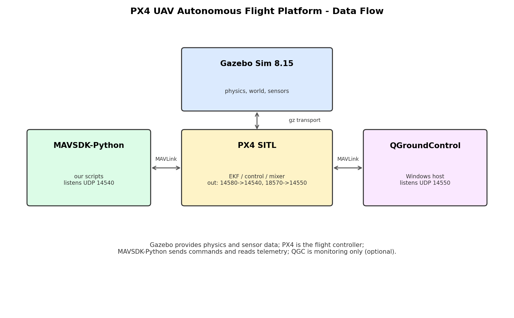

# 技术报告：PX4 无人机自主飞行与自动化测试平台

## 1. 背景与目标

本项目基于 PX4 SITL 与 Gazebo 搭建无人机软件在环仿真环境，目标是建立一个**可重复执行**的
自主飞行验证平台：能够自动执行飞行任务、按定频记录遥测、用固定判据自动给出 PASS/FAIL，
并把每次运行的证据（CSV、日志、图表）留存下来。

## 2. 系统组成与数据流

| 组件 | 位置 | 职责 |
| --- | --- | --- |
| Gazebo Sim 8.15 | Ubuntu 虚拟机 | 物理、世界、传感器仿真 |
| PX4 SITL (v1.18.0-beta1 开发版) | Ubuntu 虚拟机 | 状态估计、控制、混控 |
| MAVSDK-Python 1.4.8 | Ubuntu 虚拟机 | 自动飞行指令与遥测采集 |
| QGroundControl 5.1.4 | Windows 宿主 | 地面站监控（可选） |

链路：Gazebo ↔ PX4 通过 gz transport（lockstep）；MAVSDK ↔ PX4 通过 MAVLink UDP
（PX4 本机 14580，远端 14540）；QGC 监听 UDP 14550（PX4 主动推送）。

## 3. 方法

### 3.1 定频遥测采集

`scripts/telemetry_logger.py` 每 1.000 s 对齐采样一次，记录 13 个字段（时间、相对/绝对高度、
北东位置、三轴速度、三轴姿态、解锁状态、飞行模式），输出文件名带时间戳，避免覆盖历史数据。
默认记录 120 s，可通过环境变量 `TELEMETRY_SECONDS` 调整。
字段定义见 `docs/data_dictionary.md`。

### 3.2 测试用例设计

| 用例 | 检查内容 | 判定规则 |
| --- | --- | --- |
| TC-01 | 连接 | 10 s 内 `is_connected=True` |
| TC-02 | 遥测连续性 | 15 s 内 ≥8 个样本且时间递增 |
| TC-03 | 解锁 | 5 s 内 `armed=True` |
| TC-04 | 起飞 | 连续 3 个样本 rel_alt ≥ 2.0 m |
| TC-05 | 悬停稳定（稳定 5 s 后测 20 s） | 2.0–3.0 m，水平漂移 ≤0.5 m |
| TC-06 | 航点到达 | 连续 3 个样本水平 ≤1.0 m、高度 ≤0.5 m |
| TC-07 | 降落 | 连续 3 个样本 rel_alt ≤0.2 m |

### 3.3 判定与状态管理

- 所有判定使用**连续 3 个样本**满足阈值，避免"刚跨过阈值就判定"的乐观结果。
- 套件启动前执行前置检查：若机体在空中先降落、若已解锁先上锁（状态隔离）。
- 执行异常时执行安全收尾（降落 + 上锁），结果在 `finally` 中落盘。

## 4. 结果

### 4.1 连续三轮测试

| 轮次 | 用例数 | 通过 | 文件 |
| --- | --- | --- | --- |
| 1 | 7 | 7 | logs/test_runs/2026-10-25_192618_suite.csv |
| 2 | 7 | 7 | logs/test_runs/2026-10-25_192709_suite.csv |
| 3 | 7 | 7 | logs/test_runs/2026-10-25_192800_suite.csv |

合计 **21/21 次判定通过**。

### 4.2 关键指标

| 指标 | 实测 |
| --- | --- |
| 悬停高度 | 2.38 / 2.42 / 2.40 m（范围 2.38–2.47 m） |
| 悬停水平漂移 | 0.05 / 0.05 / 0.07 m |
| 航点水平误差 | 0.92 / 0.93 / 0.93 m |
| 航点高度误差 | 0.08 / 0.05 / 0.07 m |
| 降落高度 | 0.16 / 0.17 / 0.16 m |
| 单次飞行最大高度 | 2.47 m |
| 定频采样间隔 | 1.000 s（min = max） |

### 4.3 失败检测验证

为验证套件不会"永远打勾"，曾制造一次异常：上一轮中断后机体仍停在空中，下一轮把半空位置
当作 home，导致 TC-05/TC-06 判 FAIL，结果 **5/7**。重启仿真（干净起点）后恢复 **7/7**。
该实验同时暴露了"运行之间缺少状态隔离"的问题，已修复并记录。

### 4.4 数据分析

`analysis/analyze_logs.py` 汇总 4 份遥测、199 条样本，生成 `analysis/summary.csv`、
`analysis/suite_summary.csv` 与两张图（`figures/altitude_curve.png`、`figures/flight_kinematics.png`）。
其中发现一份旧数据存在 68 s 采样空档（known_issues 1.14），已在统计中排除。

## 5. 问题排查案例：高度口径（AMSL vs AGL）

- **现象**：三个航点高度误差均为 10 m 左右，恰好等于设定高度。
- **假设**：`goto_location()` 第三参数是绝对高度（AMSL），脚本却按相对高度使用。
- **实验**：编写探针脚本原地起飞并每秒记录相对/绝对高度；曲线显示机体先升到 2.3 m，
  收到航点指令后一路降回地面，绝对高度稳定在约 488 m（SITL home 海拔）。
- **结论**：指令中的"10"被理解为海拔 10 m，远低于 home 海拔，机体因此下降。
- **修复**：目标高度改为 `home_abs + 相对高度`；修复后高度误差从约 10 m 降至 **0.08 m 以内**。

## 6. 局限与未决问题

1. 全部结果为 SITL 仿真，未包含 HITL 或真机实验。
2. 航点水平误差稳定在 0.92–0.93 m，疑为飞控「到位接受半径」，尚未验证（1.13）。
3. 首次连接偶发挂起，需清理残留 `mavsdk_server` 后重跑（1.10）。
4. 旧采集数据存在采样空档，不影响定频采集版本（1.14）。

## 7. 结论与下一步

平台已具备"执行—记录—判定—分析"的完整闭环，并通过连续三轮测试验证了可重复性。
下一步：验证到位半径假设、补充 HITL/真机对比，并录制演示视频。

## 附：文件索引

- 用例定义：`docs/test_cases.csv`
- 数据字典：`docs/data_dictionary.md`
- 已知问题：`docs/known_issues.md`
- 测试套件：`scripts/run_test_suite.py`
- 数据分析：`analysis/analyze_logs.py`、`analysis/summary.csv`
- 数据与图表摘要：`analysis/PX4_项目数据与图表.pdf`
